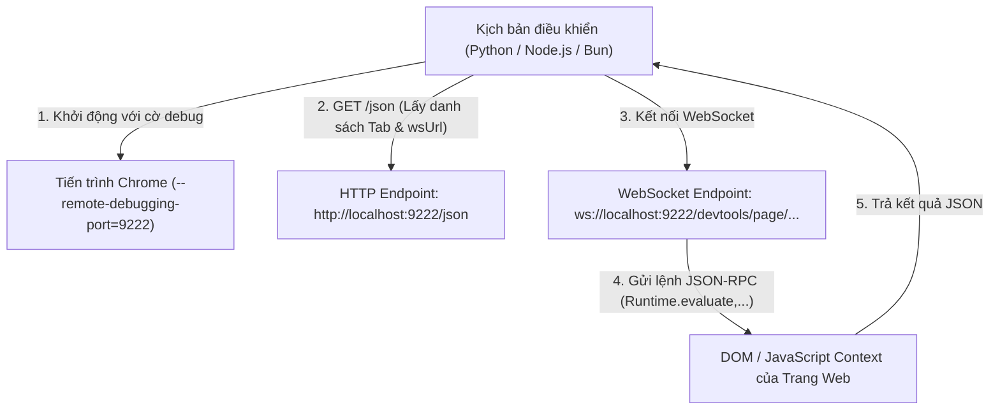

# Hướng dẫn Tự động hóa Chrome qua Chrome DevTools Protocol (CDP)

Tài liệu này tổng hợp chi tiết quy trình, cơ chế kỹ thuật và mã nguồn mẫu để tự động hóa, điều khiển trình duyệt Google Chrome từ bên ngoài thông qua giao thức **Chrome DevTools Protocol (CDP)** qua WebSocket.

---

## 1. Kiến trúc hoạt động của CDP



---

## 1.5. Kết nối trực tiếp vào Chrome mặc định (Chrome 144+ — Giữ nguyên tài khoản đã đăng nhập, không cần Extension)

Từ **Chrome 136 trở lên**, Google Chrome **chặn cờ `--remote-debugging-port`** trên thư mục `User Data` mặc định (`%LOCALAPPDATA%\Google\Chrome\User Data` trên Windows) nhằm bảo vệ cookie đăng nhập. Vì vậy nếu chỉ chạy `chrome.exe --remote-debugging-port=9222` vào profile `Default`, Chrome sẽ bỏ qua cổng 9222.

Từ **Chrome 144+**, Chrome cung cấp cơ chế cấp quyền chính thức thông qua file `DevToolsActivePort`, và **Otter CDP đã hỗ trợ sẵn tự động**:

### Các bước bật (chỉ cần làm 1 lần, ~5 giây):
1. Mở **Google Chrome mặc định** (profile đang đăng nhập sẵn Facebook, ChatGPT, Gmail,...).
2. Mở một tab mới và truy cập địa chỉ:
   ```text
   chrome://inspect/#remote-debugging
   ```
3. Gạt **ON** mục **Allow remote debugging for this browser**.
   - Chrome sẽ tự tạo file `DevToolsActivePort` trong thư mục `User Data` (chứa cổng lắng nghe và đường dẫn `/devtools/browser/<guid>`).
4. Khi Otter gửi lệnh điều khiển trình duyệt lần đầu, Chrome sẽ hiện hộp thoại xác nhận → bấm **Allow** **1 lần duy nhất**.

### Cơ chế hoạt động trong Otter (`src/daemon/cdp-bridge.ts`):
- Otter tự động phát hiện `DevToolsActivePort`, mở **1 kết nối Browser-level WebSocket duy nhất** và dùng `Target.attachToTarget({ flatten: true })` để điều khiển nhiều tab song song — nhờ đó Chrome **không hỏi lại hộp thoại Allow** ở các lệnh sau.
- Otter tự động nạp lõi **Page-Agent Core (`window.__otterCore`)** vào mọi tab qua `Page.addScriptToEvaluateOnNewDocument` (kèm click phần cứng `isTrusted: true` và `DOM.setFileInputFiles`), **không cần cài Chrome Extension**.
- Nếu bạn tắt công tắc trên, Otter tự động fallback sang profile CDP riêng (`~/.otter/cdp-profile` ở cổng `9222`) hoặc GPM Login.
- Có thể ép bỏ qua Chrome mặc định bằng biến môi trường `OTTER_CDP_USE_DEFAULT_CHROME=0`.

---

## 2. Khởi động Chrome với các cờ (flags) bắt buộc (Profile riêng / CDP :9222)

Để Chrome chấp nhận kết nối điều khiển bên ngoài và không bị xung đột với các phiên làm việc hiện có, cần truyền các đối số dòng lệnh sau:

| Đối số dòng lệnh | Mục đích & Lý do bắt buộc |
| :--- | :--- |
| `--remote-debugging-port=9222` | Mở cổng nhận lệnh CDP trên `localhost:9222`. |
| `--user-data-dir="<path>"` | **Tối quan trọng.** Chỉ định thư mục profile riêng biệt. Nếu thiếu cờ này khi đang có Chrome chạy nền, Chrome sẽ đẩy tab mới sang tiến trình cũ và **không mở cổng 9222**. |
| `--remote-allow-origins=*` | Bỏ qua kiểm tra CORS của Chrome (bắt buộc từ Chrome 111+). |
| `--ignore-certificate-errors` | Bỏ qua lỗi SSL/TLS (cần thiết khi truy cập trang quản trị Router, ONT, IP nội bộ tự ký chứng chỉ). |

### Lệnh PowerShell khởi chạy:
```powershell
Start-Process "C:\Program Files\Google\Chrome\Application\chrome.exe" `
  -ArgumentList @(
    "--remote-debugging-port=9222",
    "--remote-allow-origins=*",
    "--user-data-dir=C:\Users\NAM\chrome_dev_data",
    "--ignore-certificate-errors",
    "https://192.168.1.1"
  )
```

---

## 3. Khám phá Tab qua HTTP Endpoint (`localhost:9222/json`)

Khi Chrome đang mở cổng 9222, truy cập `GET http://localhost:9222/json` sẽ nhận được danh sách targets:

```json
[
  {
    "description": "",
    "devtoolsFrontendUrl": "/devtools/inspector.html?ws=127.0.0.1:9222/devtools/page/...",
    "id": "B01D9...",
    "title": "GPON ONT",
    "type": "page",
    "url": "https://192.168.1.1/cgi-bin/login.asp",
    "webSocketDebuggerUrl": "ws://127.0.0.1:9222/devtools/page/B01D9..."
  }
]
```

Lấy giá trị `webSocketDebuggerUrl` tương ứng với tab cần điều khiển để mở kết nối WebSocket.

---

## 4. Giao thức JSON-RPC & Domain `Runtime.evaluate`

CDP trao đổi qua WebSocket theo chuẩn JSON-RPC 2.0. Để chạy JavaScript trên trang:

```json
{
  "id": 1,
  "method": "Runtime.evaluate",
  "params": {
    "expression": "document.title",
    "returnByValue": true
  }
}
```

Kết quả trả về:
```json
{
  "id": 1,
  "result": {
    "result": {
      "type": "string",
      "value": "GPON ONT"
    }
  }
}
```

---

## 5. Kinh nghiệm thực chiến khi xử lý Web phức tạp / Router

1. **Frameset & Iframe:**
   - Nhiều thiết bị mạng cũ (như modem VNPT iGate GW040-NS) dùng cấu trúc frameset. Giao diện chức năng nằm trong frame `contentfrm`:
     ```javascript
     const doc = window.frames['contentfrm'] ? window.frames['contentfrm'].document : document;
     const win = window.frames['contentfrm'] ? window.frames['contentfrm'] : window;
     ```
2. **Kích hoạt sự kiện Form (Events):**
   - Đặt giá trị bằng JS đơn thuần không kích hoạt listener của trang. Cần gọi tường minh hàm sự kiện:
     ```javascript
     radio.checked = true;
     if (radio.onclick) radio.onclick();
     ```
3. **Gọi trực tiếp hàm lưu cấu hình của trang:**
   - Nếu trang có hàm JavaScript lưu form riêng, gọi trực tiếp từ context của frame đó (ví dụ: `win.save_dmz_form()`, `win.btnSaveIPv4()`, `win.SubmitForm()`).
4. **Kiểm tra trạng thái sẵn sàng của trang:**
   - Chờ `document.readyState === 'complete'` trước khi tìm kiếm thẻ HTML để tránh lỗi không tìm thấy element do DOM chưa render xong.

---

## 6. Script Python mẫu hoàn chỉnh

Chạy trực tiếp bằng `uv`:
```bash
uv run --with websockets python cdp_router.py
```

```python
import asyncio
import json
import subprocess
import time
import urllib.request
import websockets

CHROME_PATH = r"C:\Program Files\Google\Chrome\Application\chrome.exe"
DATA_DIR = r"C:\Users\NAM\chrome_dev_data"
ROUTER_URL = "https://192.168.1.1"

async def main():
    # 1. Khởi động Chrome
    cmd = [
        CHROME_PATH,
        "--remote-debugging-port=9222",
        "--remote-allow-origins=*",
        f"--user-data-dir={DATA_DIR}",
        "--ignore-certificate-errors",
        ROUTER_URL
    ]
    proc = subprocess.Popen(cmd)
    print(f"[*] Chrome khởi động thành công (PID: {proc.pid})")

    # 2. Đợi mở cổng 9222
    tabs = None
    for _ in range(10):
        try:
            tabs = json.loads(urllib.request.urlopen("http://localhost:9222/json", timeout=2).read())
            break
        except Exception:
            time.sleep(1)

    if not tabs:
        print("[-] Không kết nối được tới cổng CDP 9222.")
        return

    # 3. Lấy Tab mục tiêu
    target_tab = next((t for t in tabs if "192.168.1.1" in t.get("url", "")), tabs[0])
    ws_url = target_tab["webSocketDebuggerUrl"]
    print(f"[*] Kết nối WebSocket: {ws_url}")

    # 4. Giao tiếp qua WebSocket
    async with websockets.connect(ws_url) as ws:
        async def eval_js(code):
            payload = {
                "id": int(time.time() * 1000) % 100000,
                "method": "Runtime.evaluate",
                "params": {"expression": code, "returnByValue": True}
            }
            await ws.send(json.dumps(payload))
            res = json.loads(await ws.recv())
            return res.get("result", {}).get("result", {}).get("value")

        await asyncio.sleep(2)
        url = await eval_js("window.location.href")
        print("[*] URL hiện tại:", url)

        # 5. Tự động đăng nhập nếu đang ở login.asp
        if "login.asp" in url:
            print("[*] Đang tự động đăng nhập...")
            login_result = await eval_js("""
                (() => {
                    const u = document.querySelector('input[type="text"]');
                    const p = document.querySelector('input[type="password"]');
                    const btn = document.querySelector('button[name="loginbutton"], #loginbutton, button');
                    if (u && p && btn) {
                        u.value = 'admin';
                        p.value = 'Tinh@123';
                        btn.click();
                        return 'Đã bấm đăng nhập!';
                    }
                    return 'Không tìm thấy ô đăng nhập';
                })()
            """)
            print("  -> Kết quả:", login_result)
            await asyncio.sleep(4)

        # 6. Điều hướng đến trang cài đặt
        print("[*] Mở trang cấu hình NAT/DMZ...")
        await eval_js("if (window.frames['contentfrm']) window.frames['contentfrm'].location.href = '/cgi-bin/app-natset.asp';")
        await asyncio.sleep(3)

        # 7. Thao tác trên trang cấu hình (Tắt DMZ)
        res = await eval_js("""
            (() => {
                const doc = window.frames['contentfrm'] ? window.frames['contentfrm'].document : document;
                const win = window.frames['contentfrm'] ? window.frames['contentfrm'] : window;
                const dmzNo = doc.querySelector('input[name="dmz_enable"][value="No"]');
                if (dmzNo) {
                    dmzNo.checked = true;
                    if (dmzNo.onclick) dmzNo.onclick();
                }
                if (win.$ && typeof win.save_dmz_form === 'function') {
                    win.$('#dmz_action_flag').val('2');
                    win.save_dmz_form();
                    return 'Đã lưu cấu hình tắt DMZ';
                }
                return 'Không tìm thấy hàm lưu form';
            })()
        """)
        print("[*] Kết quả thực thi:", res)

if __name__ == "__main__":
    asyncio.run(main())
```

---

## 7. Script TypeScript / Bun mẫu (Tích hợp trong ChatMCP)

Chạy bằng Bun:
```bash
bun run cdp_controller.ts
```

```typescript
import { spawn } from "child_process";

const CHROME_PATH = "C:\\Program Files\\Google\\Chrome\\Application\\chrome.exe";
const DATA_DIR = "C:\\Users\\NAM\\chrome_dev_data";
const TARGET_URL = "https://192.168.1.1";

async function cdpController() {
  // 1. Khởi động Chrome
  const proc = spawn(CHROME_PATH, [
    "--remote-debugging-port=9222",
    "--remote-allow-origins=*",
    `--user-data-dir=${DATA_DIR}`,
    "--ignore-certificate-errors",
    TARGET_URL,
  ], { detached: true, stdio: "ignore" });
  proc.unref();

  // 2. Chờ HTTP 9222 sẵn sàng
  let tabs: any[] = [];
  for (let i = 0; i < 10; i++) {
    try {
      const res = await fetch("http://localhost:9222/json");
      tabs = await res.json();
      break;
    } catch {
      await new Promise((r) => setTimeout(r, 1000));
    }
  }

  const targetTab = tabs.find((t) => t.url.includes("192.168.1.1")) || tabs[0];
  if (!targetTab) throw new Error("Không tìm thấy tab phù hợp!");

  // 3. Mở WebSocket CDP
  const ws = new WebSocket(targetTab.webSocketDebuggerUrl);

  await new Promise((resolve) => ws.addEventListener("open", resolve));
  console.log("[*] Đã kết nối WebSocket CDP thành công");

  function sendCDP(method: string, params: Record<string, any>): Promise<any> {
    return new Promise((resolve) => {
      const id = Math.floor(Math.random() * 100000);
      const listener = (event: MessageEvent) => {
        const data = JSON.parse(event.data);
        if (data.id === id) {
          ws.removeEventListener("message", listener);
          resolve(data.result?.result?.value);
        }
      };
      ws.addEventListener("message", listener);
      ws.send(JSON.stringify({ id, method, params }));
    });
  }

  // 4. Lấy tiêu đề trang
  const title = await sendCDP("Runtime.evaluate", {
    expression: "document.title",
    returnByValue: true,
  });
  console.log("[*] Tiêu đề trang hiện tại:", title);

  ws.close();
}

cdpController();
```

---
Nếu dự án giúp ích cho công việc nghiên cứu hoặc phòng thủ của bạn, bạn có thể ủng hộ để duy trì tài liệu, test và các workflow mới. Mọi khoản đóng góp đều hoàn toàn tự nguyện.

- Ngân hàng: **TPBank**
- Chủ tài khoản: **PHAM THANH NAM**
- Số tài khoản: **69238686888**

<p align="center">
  
</p>
