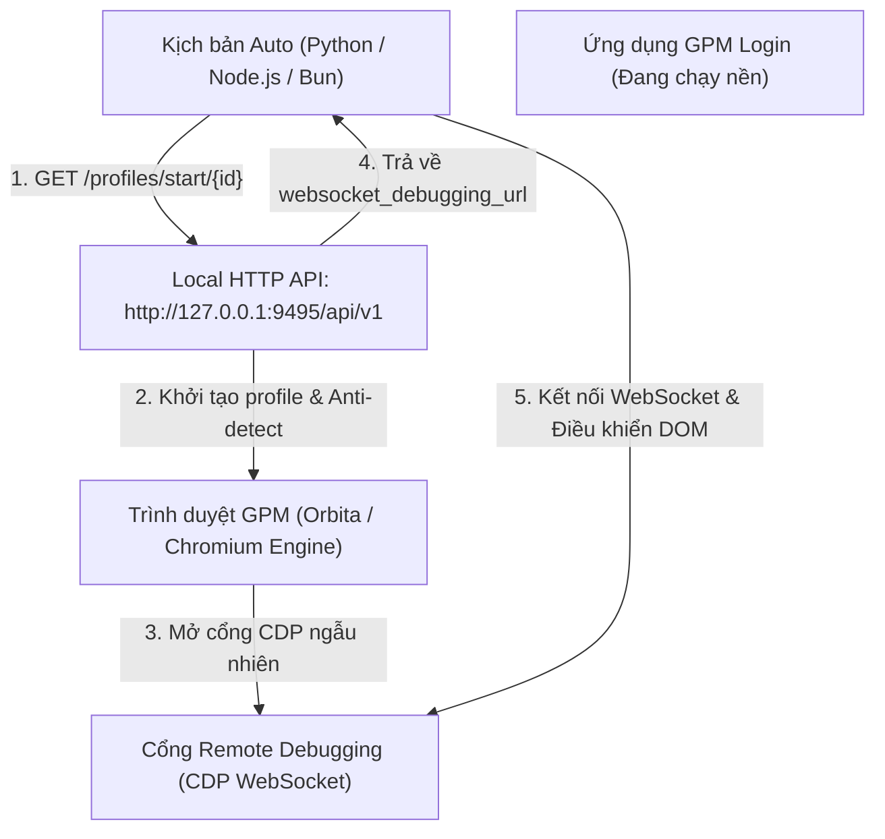

# Hướng dẫn Tự động hóa Trình duyệt qua GPM Login Local API & CDP

Tài liệu này hướng dẫn chi tiết cách kết nối, điều khiển và tự động hóa các profile trình duyệt ẩn danh (anti-detect browser) của **GPM Login** thông qua **Local API (port 9495)** kết hợp với **Chrome DevTools Protocol (CDP)**.

---

## 1. Kiến trúc tích hợp GPM Login + CDP



---

## 2. Đặc điểm của GPM Login Local API

- **Cơ chế:** HTTP RESTful Server cục bộ (chỉ lắng nghe kết nối từ `127.0.0.1` hoặc `localhost`).
- **Xác thực:** **Không cần API Token / Secret Key** (vì chỉ cho phép truy cập từ cùng máy).
- **Base URL chuẩn:** `http://127.0.0.1:9495/api/v1` (hoặc `http://localhost:9495/api/v1`).
- **Cơ chế fallback cổng:** Nếu cổng `9495` bị chiếm dụng, GPM Login sẽ tự động gán một cổng ngẫu nhiên trong dải `8000 - 10000` và lưu số cổng này vào file `http.port` trong thư mục dữ liệu của phần mềm.
- **Khuôn mẫu dữ liệu trả về (Response Standard):**
  ```json
  {
    "success": true,
    "data": { ... },
    "message": "OK",
    "sender": "GPMLogin Global"
  }
  ```

---

## 3. Bảng tra cứu Endpoint API cốt lõi

| Phương thức | Đường dẫn (Path) | Mục đích & Mô tả |
| :--- | :--- | :--- |
| `GET` | `/profiles` | Lấy danh sách profile (hỗ trợ phân trang: `?page=1&page_size=30&search=keyword`). |
| `GET` | `/profiles/{id}` | Lấy thông tin chi tiết của 1 profile kèm toàn bộ cấu hình `fingerprint`. |
| `POST` | `/profiles/create` | Tạo profile mới (Body JSON: `name`, `raw_proxy`, `browser_type`, `os_type`,...). |
| `POST` | `/profiles/update/{id}` | Cập nhật cấu hình profile (các trường null sẽ giữ nguyên). |
| `GET` | `/profiles/delete/{id}` | Xóa profile (`?mode=soft` đưa vào thùng rác; `?mode=hard` xóa vĩnh viễn đĩa). |
| `GET` | `/profiles/start/{id}` | **Mở trình duyệt profile**, trả về cổng CDP và link WebSocket điều khiển. |
| `GET` | `/profiles/stop/{id}` | Đóng cửa sổ trình duyệt của profile tương ứng. |
| `GET` | `/groups` | Danh sách các nhóm profile. |
| `GET` | `/proxies` | Quản lý kho Proxy trong ứng dụng. |

---

## 4. Chi tiết Endpoint `GET /profiles/start/{id}`

Đây là endpoint quan trọng nhất để bắt đầu tự động hóa:

### Các tham số Query tùy chọn:
- `remote_debugging_port`: Cố định cổng CDP (nếu bỏ trống, GPM tự chọn cổng trống).
- `skip_proxy_check=true`: Bỏ qua bước kiểm tra kết nối proxy lúc bật, giúp **mở trình duyệt nhanh hơn 2-3 lần**.
- `window_size=1280,720`: Đặt kích thước cửa sổ `rộng,cao`.
- `window_pos=0,0`: Đặt tọa độ mở cửa sổ `x,y`.
- `window_scale=0.8`: Tỉ lệ thu phóng cửa sổ.
- `addition_args`: Thêm cờ dòng lệnh Chromium (ví dụ: `--mute-audio`, `--disable-gpu`).

### Dữ liệu trả về (`data`):
```json
{
  "profile_id": "abc-123",
  "remote_debugging_port": 15432,
  "websocket_debugging_url": "ws://127.0.0.1:15432/devtools/page/...",
  "driver_path": "C:\\Users\\...\\chromedriver.exe",
  "addition_info": {
    "process_id": 12890,
    "profile_name": "Nam_Profile_01"
  }
}
```

---

## 5. Kịch bản mẫu hoàn chỉnh (Ready-to-Run)

### Cách 1: Python siêu nhẹ (Không cần Selenium/Playwright nặng nề)

Dùng trực tiếp `websockets` kết hợp với cổng CDP do GPM cung cấp:

```bash
uv run --with websockets python gpm_cdp_auto.py
```

```python
import asyncio
import json
import time
import urllib.request
import websockets

GPM_API_BASE = "http://127.0.0.1:9495/api/v1"
PROFILE_NAME = "Nam_Test"  # Tên profile muốn chạy

def get_profile_id(name):
    url = f"{GPM_API_BASE}/profiles?search={urllib.parse.quote(name)}"
    res = json.loads(urllib.request.urlopen(url).read())
    profiles = res.get("data", {}).get("data", [])
    for p in profiles:
        if p["name"] == name:
            return p["id"]
    return profiles[0]["id"] if profiles else None

def start_gpm_profile(profile_id):
    url = f"{GPM_API_BASE}/profiles/start/{profile_id}?skip_proxy_check=true"
    res = json.loads(urllib.request.urlopen(url).read())
    if not res.get("success"):
        raise RuntimeError(f"Không thể mở profile: {res.get('message')}")
    data = res["data"]
    return data["remote_debugging_port"], data.get("websocket_debugging_url")

def stop_gpm_profile(profile_id):
    url = f"{GPM_API_BASE}/profiles/stop/{profile_id}"
    urllib.request.urlopen(url)
    print(f"[*] Đã đóng profile: {profile_id}")

async def run_automation():
    # 1. Tìm Profile ID
    profile_id = get_profile_id(PROFILE_NAME)
    if not profile_id:
        print(f"[-] Không tìm thấy profile có tên: {PROFILE_NAME}")
        return

    print(f"[*] Tìm thấy Profile ID: {profile_id}")

    # 2. Mở Profile qua GPM Login API
    port, ws_url = start_gpm_profile(profile_id)
    print(f"[*] Profile đã mở trên cổng CDP: {port}")

    # Nếu GPM chưa trả về ws_url hoặc cần lấy tab đầu tiên
    if not ws_url:
        tabs = json.loads(urllib.request.urlopen(f"http://127.0.0.1:{port}/json").read())
        ws_url = tabs[0]["webSocketDebuggerUrl"]

    # 3. Kết nối WebSocket CDP và tự động hóa
    async with websockets.connect(ws_url) as ws:
        async def eval_js(code):
            payload = {
                "id": int(time.time() * 1000) % 100000,
                "method": "Runtime.evaluate",
                "params": {"expression": code, "returnByValue": True}
            }
            await ws.send(json.dumps(payload))
            res = json.loads(await ws.recv())
            return res.get("result", {}).get("result", {}).get("value")

        # Điều hướng trang web
        print("[*] Đang điều hướng đến trang kiểm tra IP...")
        await eval_js("window.location.href = 'https://whoer.net'")
        await asyncio.sleep(5)

        # Đọc thông tin đã render từ DOM
        title = await eval_js("document.title")
        print(f"[*] Tiêu đề trang: {title}")

        current_ip = await eval_js("document.querySelector('.your-ip')?.innerText")
        print(f"[*] IP hiển thị trên trang: {current_ip}")

    # 4. Đóng profile khi xong việc (tùy chọn)
    # stop_gpm_profile(profile_id)

if __name__ == "__main__":
    asyncio.run(run_automation())
```

---

### Cách 2: Tích hợp với Playwright (Node.js / Bun / TypeScript)

Playwright hỗ trợ kết nối trực tiếp vào profile GPM Login qua hàm `chromium.connectOverCDP`:

```typescript
import { chromium } from "playwright";

const GPM_API = "http://127.0.0.1:9495/api/v1";
const PROFILE_ID = "YOUR_PROFILE_ID_HERE";

async function main() {
  // 1. Gọi API GPM Login để mở profile
  const startRes = await fetch(`${GPM_API}/profiles/start/${PROFILE_ID}?skip_proxy_check=true`);
  const data = await startRes.json();
  
  if (!data.success) {
    throw new Error(`Lỗi mở profile: ${data.message}`);
  }

  const wsEndpoint = data.data.websocket_debugging_url;
  console.log(`[*] Kết nối Playwright tới: ${wsEndpoint}`);

  // 2. Nối Playwright qua CDP
  const browser = await chromium.connectOverCDP(wsEndpoint);
  const context = browser.contexts()[0];
  const page = context.pages()[0] || (await context.newPage());

  // 3. Sử dụng đầy đủ tính năng mạnh mẽ của Playwright
  await page.goto("https://facebook.com");
  console.log("[*] Tiêu đề:", await page.title());

  // Thao tác click, gõ text với selector chuẩn
  // await page.fill('input[name="email"]', 'my_user');

  // 4. Ngắt kết nối (không làm tắt trình duyệt GPM)
  await browser.close();
}

main().catch(console.error);
```

---

## 6. Mẹo & Bẫy thường gặp (Tips & Pitfalls)

1. **Proxy vs Mạng LAN nội bộ:**
   - Nếu dùng profile GPM để truy cập router/máy chủ nội bộ (`192.168.1.1` hoặc `192.168.1.3`), profile đó **BẮT BUỘC KHÔNG ĐƯỢC GẮN PROXY**, hoặc phải cấu hình dải IP LAN trong trường `bypass_proxy_extensions`.
2. **Tối ưu tốc độ mở trình duyệt:**
   - Luôn thêm query `skip_proxy_check=true` khi gọi `/profiles/start/{id}` để bỏ qua bước ping test proxy tốn từ 2-5 giây của GPM.
3. **Phân biệt Nhân Chromium vs Nhân Firefox:**
   - Chỉ các profile nhân **Chromium** (Chrome, Brave, Edge, Opera) mới hỗ trợ cổng CDP WebSocket. Các profile tạo bằng nhân Firefox sẽ không điều khiển được bằng CDP.
4. **Tránh trùng lặp phiên mở (Cache Instance):**
   - Nếu profile đang mở sẵn trên màn hình, gọi lại `/profiles/start/{id}` sẽ lập tức trả về `remote_debugging_port` hiện tại mà không tạo thêm tiến trình mới.

---
Nếu dự án giúp ích cho công việc nghiên cứu hoặc phòng thủ của bạn, bạn có thể ủng hộ để duy trì tài liệu, test và các workflow mới. Mọi khoản đóng góp đều hoàn toàn tự nguyện.

- Ngân hàng: **TPBank**
- Chủ tài khoản: **PHAM THANH NAM**
- Số tài khoản: **69238686888**

<p align="center">
  
</p>
