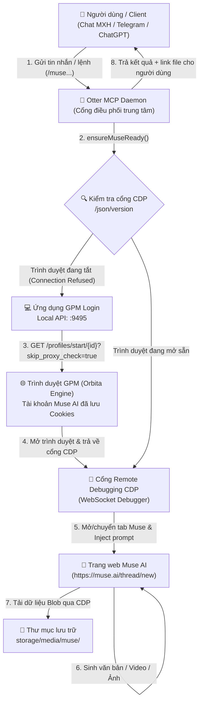

# Hướng Dẫn Kiến Trúc & Vận Hành: Quản Lý Tài Khoản Muse AI Qua GPM Login & CDP (Cơ Chế Auto-Wakeup Khi Nhận Tin Nhắn)

Tài liệu này hướng dẫn chi tiết giải pháp quản lý tài khoản **Muse AI** bằng trình duyệt chống phát hiện (**GPM Login**) kết hợp với giao thức **Chrome DevTools Protocol (CDP)**, tích hợp cơ chế **tự động phục hồi và đánh thức (On-Demand Auto-Wakeup)**: khi trình duyệt bị tắt giữa chừng, chỉ cần có tin nhắn hoặc lệnh gửi tới là hệ thống tự khởi động lại trình duyệt, mở tab và thực hiện nhiệm vụ ngay lập tức.

---

## 1. Bối Cảnh & Vấn Đề Kỹ Thuật

- **Vấn đề thực tế**:
  - Trình duyệt chạy Muse AI thường xuyên bị đóng ngắt giữa chừng do người dùng tắt nhầm, máy tính rơi vào trạng thái ngủ (Sleep), thiếu bộ nhớ RAM, hoặc tiến trình Chrome bị crash.
  - Nếu duy trì trình duyệt mở 24/7 sẽ gây tiêu tốn tài nguyên máy tính (RAM, CPU), nóng máy và dễ bị treo trang web.
  - Khi có lệnh gửi từ Chat MXH (`/muse <nhiệm vụ>`), Telegram, hoặc ChatGPT Custom GPT, nếu trình duyệt đang tắt thì yêu cầu sẽ bị lỗi ngay lập tức (`Connection Refused` hoặc `Target Unreachable`).
- **Mục tiêu giải pháp**:
  - **Tối ưu tài nguyên**: Cho phép trình duyệt được tắt tự do khi không có việc.
  - **Tự động hóa 100%**: Mỗi khi có tin nhắn yêu cầu gửi tới, hệ thống tự phát hiện trạng thái, tự gọi API của GPM Login để bật profile lên, tự kết nối cổng CDP, mở tab Muse và gõ lệnh chạy mà không cần bất kỳ sự can thiệp thủ công nào.

---

## 2. Kiến Trúc Tổng Thể (Architecture)



---

## 3. Các Thành Phần Cốt Lõi

### 3.1. Quản lý Profile bằng GPM Login Local API
- **Endpoint mở profile**: `GET http://127.0.0.1:9495/api/v1/profiles/start/{profile_id}`
- **Tham số quan trọng**:
  - `skip_proxy_check=true`: Bỏ qua kiểm tra proxy khi bật, rút ngắn thời gian khởi động từ 8 giây xuống chỉ còn **1.5 - 2 giây**.
  - `addition_args=--load-extension="<path>/extension/dist"`: Tự động gắn kèm Otter Chrome Extension nếu cần.
- **Dữ liệu trả về**:
  ```json
  {
    "success": true,
    "data": {
      "profile_id": "abc-123-muse",
      "remote_debugging_port": 15432,
      "websocket_debugging_url": "ws://127.0.0.1:15432/devtools/page/...",
      "driver_path": "C:\\...\\chromedriver.exe"
    }
  }
  ```

### 3.2. Điều khiển trực tiếp qua Chrome DevTools Protocol (CDP)
- Sau khi có cổng CDP (ví dụ `15432`), Otter giao tiếp trực tiếp qua HTTP / WebSocket:
  - `GET http://127.0.0.1:15432/json/version`: Kiểm tra nhanh tiến trình trình duyệt còn sống hay không (Ping trong 300ms).
  - `GET http://127.0.0.1:15432/json/list`: Lấy danh sách tất cả các tab đang mở.
  - `PUT http://127.0.0.1:15432/json/new?https://muse.ai/thread/new`: Mở tab Muse mới nếu chưa có tab nào.
  - `Target.attachToTarget` & `Runtime.evaluate`: Điền nội dung prompt vào khung nhập liệu của Muse, kích hoạt sự kiện React Virtual DOM và bấm gửi.

---

## 4. Kịch Bản Tự Động Đánh Thức (Implementation Logic)

Module `src/daemon/services/muse-watchdog.ts`:

```typescript
import { GPM_LOGIN_API_BASE, startGpmProfile } from "../gpm";

export class MuseWatchdogService {
  private profileId: string;
  private cdpPort: number | null = null;
  private isStarting = false;

  constructor(profileId: string) {
    this.profileId = profileId;
  }

  /**
   * 1. Kiểm tra cổng CDP xem trình duyệt profile có đang mở không
   */
  async isBrowserAlive(port: number | null): Promise<boolean> {
    if (!port) return false;
    try {
      const res = await fetch(`http://127.0.0.1:${port}/json/version`, {
        signal: AbortSignal.timeout(800)
      });
      return res.ok;
    } catch {
      return false;
    }
  }

  /**
   * 2. Đảm bảo trình duyệt và tab Muse sẵn sàng (Tự bật nếu đang tắt)
   */
  async ensureMuseReady(): Promise<{ cdpPort: number; wsUrl?: string }> {
    // Chống race condition nếu nhiều tin nhắn đến cùng 1 lúc
    while (this.isStarting) {
      await new Promise(r => setTimeout(r, 500));
    }

    const alive = await this.isBrowserAlive(this.cdpPort);
    if (alive && this.cdpPort) {
      // Đã sẵn sàng
      await this.ensureMuseTab(this.cdpPort);
      return { cdpPort: this.cdpPort };
    }

    // Nếu đã tắt -> Bắt đầu quy trình khởi động lại
    this.isStarting = true;
    console.log(`[Muse Watchdog] ⚠️ Trình duyệt Muse đang tắt. Bắt đầu tự động khởi động Profile GPM ${this.profileId}...`);

    try {
      const startResult = await startGpmProfile(this.profileId, {
        skipProxyCheck: true,
        loadOtterExtension: true
      });

      if (!startResult.success || !startResult.port) {
        throw new Error(startResult.message || "Không thể khởi động profile GPM");
      }

      this.cdpPort = startResult.port;
      console.log(`[Muse Watchdog] ✅ Khởi động thành công! Cổng CDP: ${this.cdpPort}`);

      // Đợi trình duyệt nạp giao diện trong 1-2 giây
      await new Promise(r => setTimeout(r, 1500));
      await this.ensureMuseTab(this.cdpPort);

      return { cdpPort: this.cdpPort, wsUrl: startResult.wsUrl };
    } finally {
      this.isStarting = false;
    }
  }

  /**
   * 3. Kiểm tra và mở tab Muse.ai nếu chưa có
   */
  async ensureMuseTab(port: number): Promise<string> {
    try {
      const listRes = await fetch(`http://127.0.0.1:${port}/json/list`);
      const tabs = await listRes.json();
      
      const museTab = tabs.find((t: any) => t.url?.includes("muse.ai"));
      if (museTab) {
        return museTab.id;
      }

      // Chưa có tab -> Mở tab mới
      const newTabRes = await fetch(`http://127.0.0.1:${port}/json/new?https://muse.ai/thread/new`, {
        method: "PUT"
      });
      const newTab = await newTabRes.json();
      return newTab.id;
    } catch (e: any) {
      console.warn("[Muse Watchdog] Lỗi khi quản lý tab Muse:", e.message);
      return "";
    }
  }
}
```

---

## 5. Tích Hợp Vào Hệ Thống Nhắn Tin & Slash Commands

Khi người dùng gửi lệnh trong nhóm chat MXH hoặc Socket Messenger:

```typescript
// Trong Socket handler hoặc REST endpoint:
if (command === "/muse" || toolName === "ask_muse_agent") {
  // 1. Kích hoạt Watchdog tự đánh thức GPM Profile
  const watchdog = new MuseWatchdogService(process.env.GPM_MUSE_PROFILE_ID!);
  const { cdpPort } = await watchdog.ensureMuseReady();

  // 2. Chuyển tiếp tin nhắn cho Muse xử lý qua CDP
  const result = await dispatchTaskToMuse(cdpPort, userPrompt);
  
  // 3. Phản hồi Action Card về cuộc trò chuyện
  sendActionCard(conversationId, result);
}
```

---

## 6. Bảng Tra Cứu Biến Môi Trường (Environment Variables)

| Tên biến | Giá trị mẫu | Mục đích & Mô tả |
| :--- | :--- | :--- |
| `GPM_MUSE_PROFILE_ID` | `8a9b7c6d-e4f5-...` | ID Profile GPM chứa tài khoản Muse đã đăng nhập sẵn. |
| `GPM_LOGIN_API_BASE` | `http://127.0.0.1:9495/api/v1` | URL Local API của phần mềm GPM Login trên máy. |
| `MUSE_AUTO_CLOSE_IDLE_MINS`| `15` | (Tùy chọn) Tự động đóng profile nếu sau 15 phút không có tin nhắn mới để tiết kiệm RAM. |
| `MUSE_MEDIA_STORAGE_DIR` | `storage/media/muse` | Thư mục cục bộ dùng để lưu trữ file video/ảnh tải về từ Muse. |

---

## 7. Các Lợi Điểm Đột Phá

1. **Khả năng tự phục hồi 100% (Zero Downtime for User)**:
   - Dù profile trình duyệt bị tắt do bất kỳ lý do gì, khi có tin nhắn mới tới, hệ thống chỉ mất thêm **~2 giây** để tự khởi động lại và nhận lệnh như bình thường.
2. **Tiết kiệm tài nguyên tuyệt đối**:
   - Máy tính không cần giữ hàng chục tab Chrome ngốn nhiều GB RAM liên tục. Có thể cài đặt chế độ nhàn rỗi (idle) tự đóng profile, khi nào có khách nhắn tin thì mới bật lên.
3. **An toàn tài khoản (Anti-Ban & Fingerprint)**:
   - Mỗi tài khoản Muse nằm trong một bộ vân tay (Canvas, WebGL, AudioContext, Screen Resolution) cố định của GPM Login, không bị Google/Meta/Muse đánh dấu đăng nhập bất thường.
